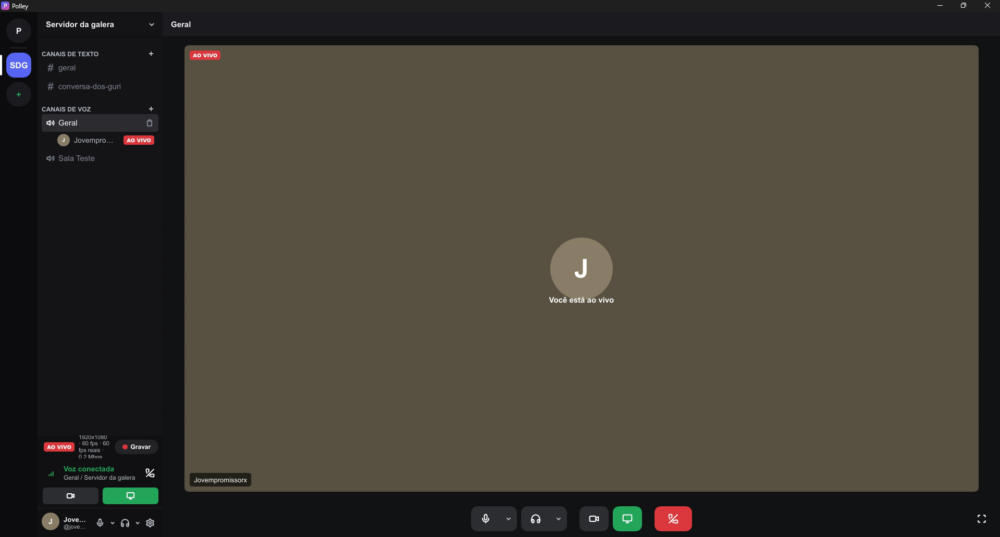
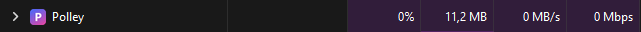
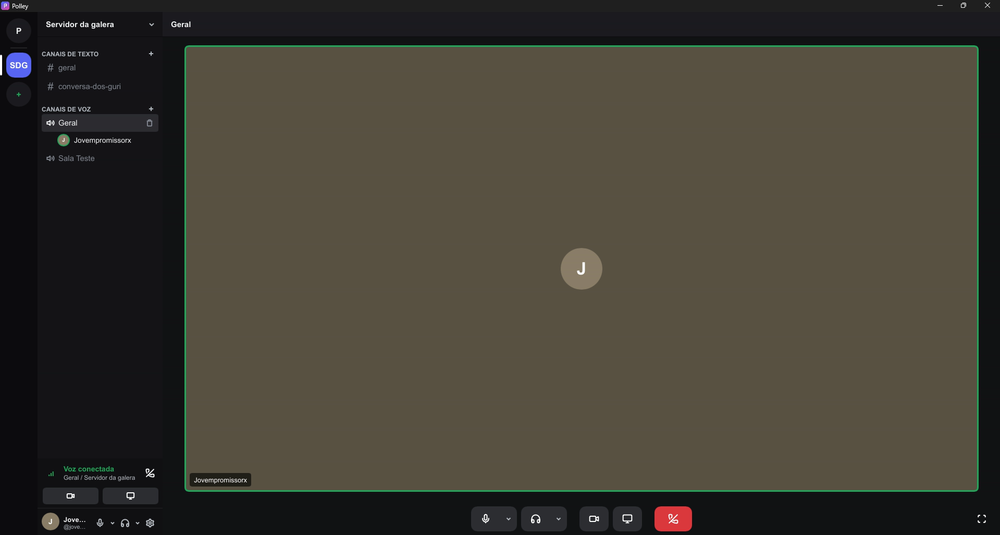
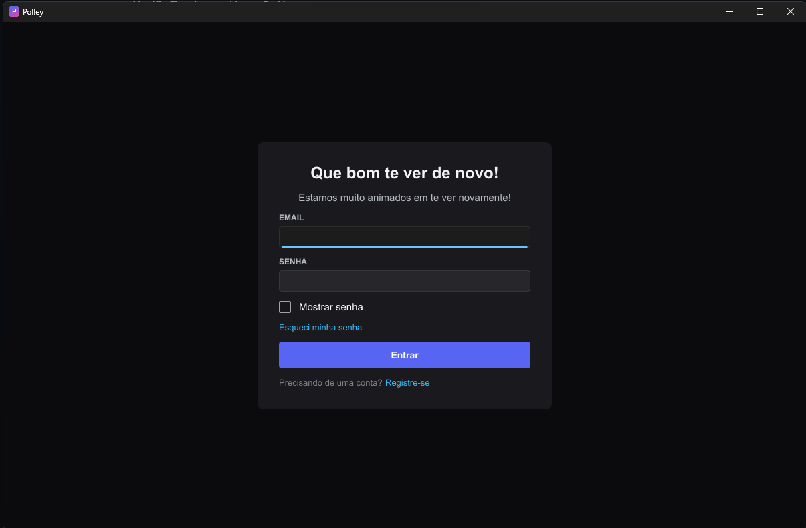
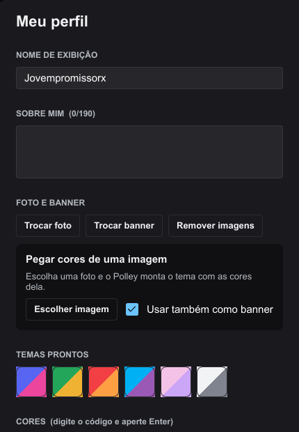

# Polley

App de desktop para comunidades: amigos, mensagens diretas, servidores com canais de texto e voz, chamadas de voz e vídeo e **transmissão de tela ao vivo em até 4K a 60 fps com o som do PC**.

É um app **nativo em Rust** para Windows. A primeira versão era em Electron. A reescrita trouxe a transmissão em 1080p/60 fps para **cerca de 43 MB de RAM** (medido no Gerenciador de Tarefas durante uma live).

> **Status:** em desenvolvimento.



## Consumo de memória

Medido no Gerenciador de Tarefas do Windows, na versão 0.2.8:

| Situação | RAM | Medição |
|---|---|---|
| Aberto, sem chamada | 11,2 MB |  |
| Em chamada de voz | 23,6 MB |  |
| Em chamada com a câmera ligada | 32,5 MB |  |
| Ao vivo em 1080p a 60 fps | 42,2 MB |  |

## Telas

<table>
  <tr>
    <td colspan="2"></td>
  </tr>
  <tr>
    <td></td>
    <td></td>
  </tr>
</table>

## Recursos

- Amigos, pedidos de amizade, bloqueio e mensagens diretas
- Servidores com canais de texto e de voz, código de convite, cargos e moderação
- Reações, respostas, anexos privados e contagem de não lidas
- Chamadas de voz e vídeo, com escolha de microfone, câmera e saída de som
- **Go Live**: transmissão de tela ou janela em 720p, 1080p, 1440p ou 4K, a 30 ou 60 fps, com o som do PC
- Gravação de tela no PC
- "Jogando agora" (detecta o jogo aberto pelo nome do processo, sem tocar no jogo)
- Silenciar e desativar áudio de membros pelo moderador, aplicado no servidor
- Perfil com cores extraídas da imagem, verificação em 2 etapas, preferências e atalhos
- Ícone na bandeja do sistema, sons e emojis
- Atualização automática com **assinatura Ed25519** e instalador próprio

## Arquitetura

```
native/
  polley/         o app: interface em Slint, lógica, Supabase, voz e atualização
  media/          motor de mídia (captura, conversão, codificação, áudio, câmera)
  stream-proto/   protótipo de linha de comando para medir transmissão e RAM
  release-tool/   gera a chave e assina as versões para a atualização automática
  installer/      instalador NSIS e script de publicação
supabase/         banco (migrações com RLS), funções e modelos de e-mail
```

### Por que gasta tão pouca memória

A imagem **nunca sai da placa de vídeo até estar comprimida**:

```
tela → Windows Graphics Capture (textura na GPU)
     → conversão para NV12 e escala na GPU (Direct3D 11)
     → H.264 por hardware: NVENC direto no driver (NVIDIA, ponte em C++)
                           ou Media Foundation (Intel QuickSync / AMD AMF)
     → LiveKit (WebRTC)
```

Não há navegador embutido nem cópia dos quadros para a memória do processo. A interface é desenhada com [Slint](https://slint.dev).

**Áudio:** microfone com cancelamento de eco e captura do som do PC sem o som do próprio Polley (WASAPI).

### Serviços

- **Supabase:** login, Postgres com regras de segurança (RLS), Realtime, Storage e Edge Functions (token de voz, exclusão de conta)
- **LiveKit Cloud:** voz, vídeo e Go Live

## Rodar

1. Crie um projeto no Supabase e rode as migrações de `supabase/migrations/` em ordem.
2. Crie um projeto no LiveKit Cloud e publique a função `supabase/functions/livekit-token` com os secrets `LIVEKIT_API_KEY` e `LIVEKIT_API_SECRET`.
3. Copie `.env.example` para `.env` **na raiz** e preencha. O build embute esses valores no executável.
4. Compile:

```powershell
cd native
cargo run --release -p polley
```

Para medir só a transmissão e a memória: `cargo run --release -p stream-proto -- record --res 1080 --fps 60`.

## Gerar o instalador

```powershell
cd native
powershell -ExecutionPolicy Bypass -File installer\build.ps1 -Novidades "o que mudou"
```

Gera `native\release\Polley-Nativo-Setup-<versão>.exe` e o `latest.json` assinado. Envie os dois para o bucket `releases` do Supabase.

## Licença

[PolyForm Noncommercial 1.0.0](LICENSE). Pode ler, estudar e testar, mas uso comercial e venda precisam de autorização.

© Gabriel Serra da Rosa
